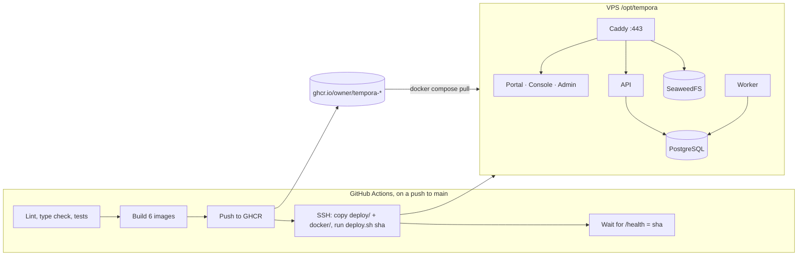

# Deploying Tempora to a VPS

The live demo runs on one small VPS (2 vCPU, 2 GB RAM, 40 GB NVMe, Ubuntu 24.04) with Docker Compose. Why it is set up this way is in the [FSD](../../../docs/booking-saas/FSD.md) (0.2 Hosting, 10).

**Everything is built by GitHub Actions; the server only runs images.** Building the three Next.js apps needs more memory than the server has, so the server never builds anything and holds no source code. It receives two things:

1. **Images** from GitHub Container Registry (GHCR), tagged with the commit SHA.
2. **This folder and `../docker`** (Compose file, Caddyfile, scripts, database init script), copied over SSH into `/opt/tempora`.



| File | Purpose |
|---|---|
| `compose.yml` | The production stack: Caddy, PostgreSQL, SeaweedFS, Mailpit, migrations, API, worker, three apps |
| `Caddyfile` | HTTPS and routing by host name |
| `.env.example` | Every server setting; the server's copy is `deploy/.env`, which CI never overwrites |
| `deploy.sh` | Pulls and starts a given commit's images (CI runs it; also the rollback) |
| `backup.sh` | Nightly database dump, last 7 kept |

On the server:

```text
/opt/tempora/
├── deploy/        compose.yml, Caddyfile, deploy.sh, backup.sh, .env (secrets, yours)
└── docker/        postgres/init/01-roles.sh, storage/start.sh
```

## Memory budget

| Service | Limit | Typical |
|---|---|---|
| PostgreSQL | 384 MB | 150–250 MB |
| API | 320 MB | ~120 MB |
| Worker | 256 MB | ~80 MB |
| Portal, Console, Platform Admin | 256 MB each | ~100 MB each |
| SeaweedFS | 256 MB | ~80 MB |
| Caddy, Mailpit | 128 MB, 64 MB | ~40 MB |

Typical use is about 1 GB, which leaves room for the operating system and Docker. The 2 GB swap file only absorbs spikes.

## 1. DNS

Five `A` records point to the server's IPv4 address (`<domain>` is the project host, e.g. `tempora.example.com`; the others are its siblings, e.g. `console-tempora.example.com`):

| Name | Type | Value |
|---|---|---|
| `<domain>` | A | server IP |
| `console-<domain>` | A | server IP |
| `admin-<domain>` | A | server IP |
| `api-<domain>` | A | server IP |
| `files-<domain>` | A | server IP |

A wildcard cannot express `*-<domain>`, so these are five separate records; the names stay one level below the portfolio domain. Check with `nslookup api-<domain>` before going on: Caddy can only get certificates once the names resolve. If the provider forwards ports 80/443 by host name (shared IP), register the same five names in its panel too.

## 2. Server, once (as root)

```sh
# A deploy user with your SSH key; root and passwords stop working for SSH afterwards.
adduser deploy
usermod -aG sudo deploy
rsync --archive --chown=deploy:deploy ~/.ssh /home/deploy
# Test `ssh deploy@<server>` in a second terminal before running the next two lines.
printf 'PasswordAuthentication no\nPermitRootLogin no\n' > /etc/ssh/sshd_config.d/10-hardening.conf
sshd -t && systemctl reload ssh

# Firewall: SSH, HTTP and HTTPS only.
# Docker bypasses ufw for published ports, which is why compose.yml publishes only Caddy's
# 80/443 and binds Mailpit to 127.0.0.1.
ufw allow OpenSSH
ufw allow 80,443/tcp
ufw allow 443/udp
ufw enable

# 2 GB swap, used only under pressure.
fallocate -l 2G /swapfile && chmod 600 /swapfile && mkswap /swapfile && swapon /swapfile
echo '/swapfile none swap sw 0 0' >> /etc/fstab
echo 'vm.swappiness=10' > /etc/sysctl.d/99-swap.conf && sysctl --system

# Docker Engine and the Compose plugin (official install script).
curl -fsSL https://get.docker.com | sh
usermod -aG docker deploy

# Security updates install themselves (on by default on Ubuntu; check it is active).
systemctl is-active unattended-upgrades

mkdir -p /opt/tempora/deploy && chown -R deploy:deploy /opt/tempora
```

Membership of the `docker` group is equivalent to root on that machine. That is why the deploy user gets its own SSH key for CI (step 3), and why nothing else runs under it.

## 3. The server's settings, once

From the repository on your own computer, copy the settings template to the server, then fill it in there:

```sh
scp Backend/booking-api/deploy/.env.example deploy@<server>:/opt/tempora/deploy/.env
ssh deploy@<server>
chmod 600 /opt/tempora/deploy/.env
nano /opt/tempora/deploy/.env   # secrets: openssl rand -base64 32 | tr -d '/+=' | cut -c1-40
```

`IMAGE_OWNER` is your GitHub user name in lower case.

## 4. GitHub Actions access to the server, once

CI logs in to the server with a key used for nothing else, and checks the server's identity against a stored host key (it never accepts an unknown server).

1. Make the key on your own computer (no passphrase, since CI cannot type one):
   ```sh
   ssh-keygen -t ed25519 -f tempora-deploy -C github-actions-deploy -N ""
   ```
2. Let it in on the server:
   ```sh
   cat tempora-deploy.pub | ssh deploy@<server> 'cat >> ~/.ssh/authorized_keys'
   ```
3. Read the server's host key, and compare its fingerprint with the one the server reports:
   ```sh
   ssh-keyscan -t ed25519 <server ip> > known_host.txt
   ssh-keygen -lf known_host.txt                                      # on your computer
   ssh deploy@<server> ssh-keygen -lf /etc/ssh/ssh_host_ed25519_key.pub # must print the same
   ```
4. In the repository on GitHub, **Settings → Secrets and variables → Actions**:

   | Name | Tab | Value |
   |---|---|---|
   | `VPS_HOST` | Secrets | server IP |
   | `VPS_USER` | Secrets | `deploy` |
   | `VPS_PORT` | Secrets | `22` (optional) |
   | `VPS_SSH_KEY` | Secrets | the whole content of `tempora-deploy` (the private key, including the `BEGIN`/`END` lines) |
   | `VPS_KNOWN_HOSTS` | Secrets | the content of `known_host.txt` |
   | `TEMPORA_DOMAIN` | Variables | `<domain>`; setting it turns deploys on |
   | `TEMPORA_APP_TIME_ZONE` | Variables | same as `APP_TIME_ZONE` in `.env` (optional, default `America/New_York`) |

5. Delete `tempora-deploy` and `known_host.txt` from your computer; GitHub keeps the only copy the pipeline needs. Pushing images needs no secret: the workflow's own `GITHUB_TOKEN` may write packages.

## 5. What CI does on every push to `main`

| Job | Runs | Result |
|---|---|---|
| `verify` | format, headers, lint, build, type check, unit tests | — |
| `database` | migrations and integration tests against PostgreSQL | — |
| `docker` | builds the six images with the production URLs (`TEMPORA_DOMAIN`) and pushes them as `:<sha>` and `:latest` | images on GHCR |
| `deploy` | copies `deploy/` and `docker/`, runs `deploy.sh <sha>`, waits until `https://api-<domain>/health` reports that SHA | site updated |

`deploy` only starts when the three jobs before it passed, so a failing test never reaches the server. Pull requests run the same checks and build the images without pushing them.

## 6. First deploy

1. Merge to `main` (or open **Actions → CI → Run workflow** on `main`). The `docker` job pushes six images to `ghcr.io/<owner>/tempora-*`.
2. New GHCR packages are private, so this first `deploy` fails at `docker compose pull`. On GitHub, open **your profile → Packages**, and for each of the six `tempora-*` packages: **Package settings → Change visibility → Public**. Then **Re-run failed jobs** on that workflow run.
3. Load the demo data once, on the server:
   ```sh
   cd /opt/tempora/deploy && docker compose run --rm seed
   ```
4. Open `https://<domain>`.
5. Install the nightly backup: `mkdir -p ~/backups`, then `crontab -e` with the line from `backup.sh`.

## Day to day

```sh
cd /opt/tempora/deploy
docker compose ps                       # status and health
docker compose logs -f api worker       # follow logs
docker stats --no-stream                # memory per container
docker compose run --rm seed --reset    # put the demo back to its seed state
```

Commands like these use the images of the last deploy: `deploy.sh` writes its commit SHA to `IMAGE_TAG` in `.env`.

**Roll back:** in GitHub Actions, open an earlier successful run on `main` and re-run its `deploy` job, or on the server run `sh /opt/tempora/deploy/deploy.sh <older sha>`. Migrations are backward compatible, so the database stays as it is.

**Emails** to demo addresses (`@demo.test`) appear in the public demo inbox at `https://<domain>/demo-inbox`. Every other email stays on the server in Mailpit until an email provider is chosen. Read them from your computer through a tunnel: `ssh -L 8025:localhost:8025 deploy@<server>`, then open `http://localhost:8025`.

**Restore a backup:**

```sh
docker compose stop api worker
docker compose exec -T postgres pg_restore -U tempora -d tempora --clean --if-exists < ~/backups/tempora-<time>.dump
docker compose start api worker
```

`pg_restore` brings back tables, data and RLS policies. The database roles are created by `docker/postgres/init/01-roles.sh` on the first start and are not part of the dump.
