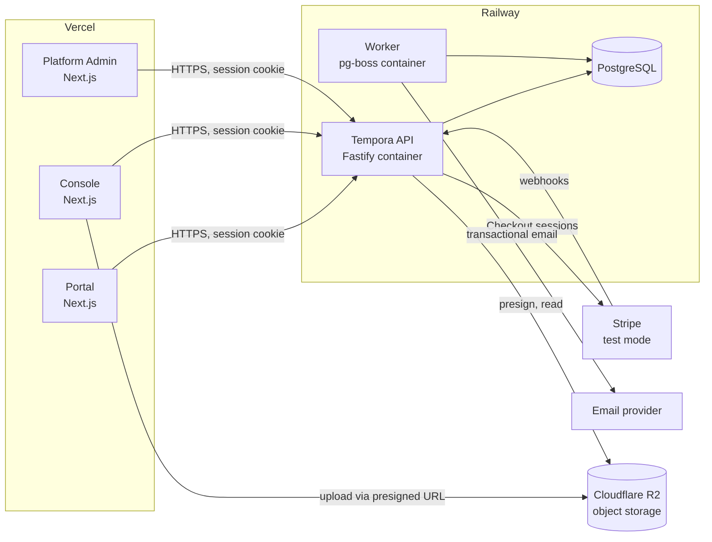
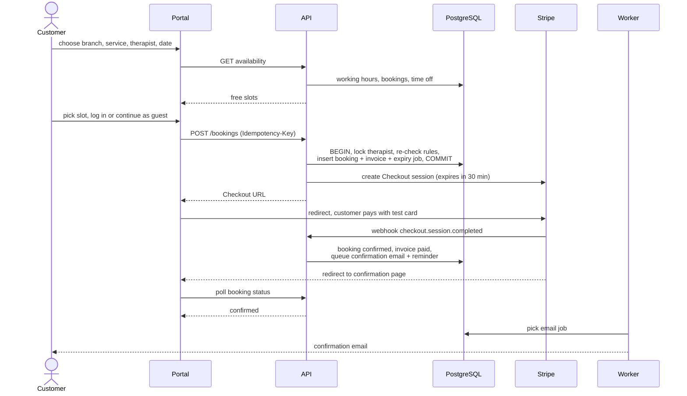
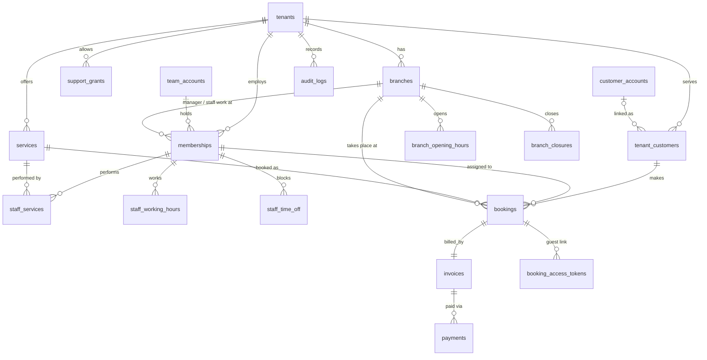
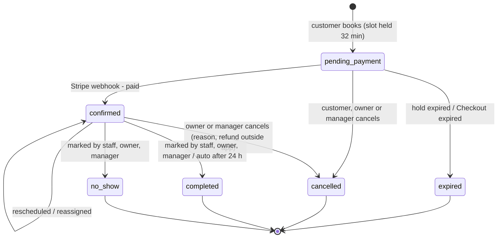
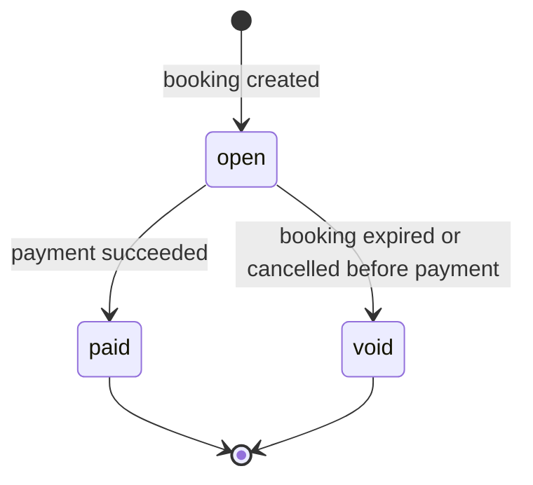
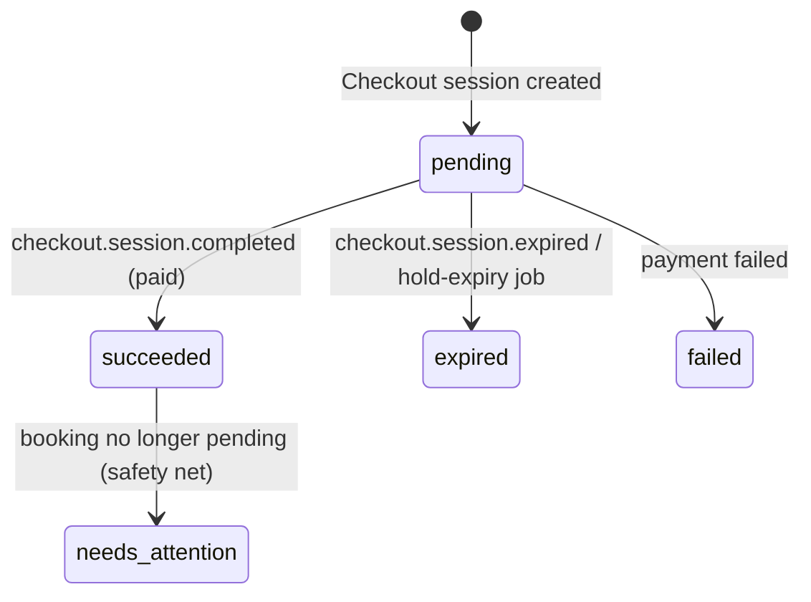
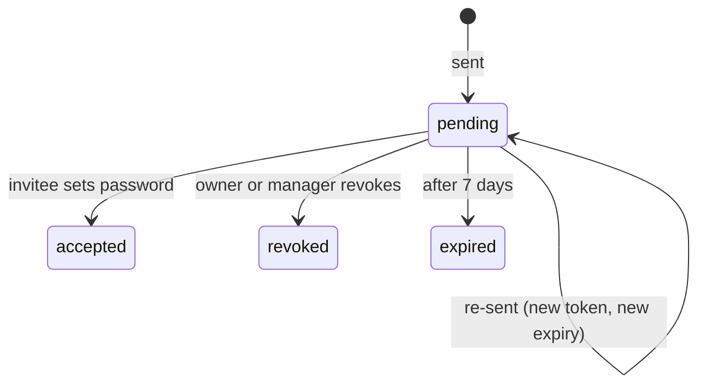

# Booking & Invoicing SaaS — FSD

**Status:** Approved · Based on [PRD](PRD.md)

## 0. Architecture & technical decisions

### 0.1 System overview


| Domain | Serves |
|---|---|
| `portal.<domain>` | Tempora Portal |
| `console.<domain>` | Tempora Console |
| `admin.<domain>` | Tempora Platform Admin |
| `api.<domain>` | Tempora API (`/v1/...`) and Stripe webhooks |

All apps live under one purchased domain, so session cookies are first-party and work without proxies.

### 0.2 Decisions
| Area | Decision | Why |
|---|---|---|
| Repository | One pnpm workspace + Turborepo at the repo root, covering `Frontend/booking-saas/*` and `Backend/booking-api/*` | One install, one CI pipeline, and shared TypeScript code between frontend and backend. Turborepo only rebuilds and retests what changed. |
| API contract | Zod schemas and TypeScript types in a package owned by the API (`Backend/booking-api/packages/contracts`), imported by the three apps | The API owns its contract. When an endpoint changes, every frontend that uses it fails to type-check instead of failing at runtime. The same schemas validate requests in the API and forms in the apps. |
| API framework | Fastify (Node.js + TypeScript) | Built-in schema validation, OpenAPI generated from the same schemas, and a plugin system that keeps modules (auth, tenancy, booking, billing) separated. |
| API style | REST, versioned under `/v1`, OpenAPI documentation, errors in the RFC 9457 *problem details* format | REST is what most client teams expect and integrate with; a standard error format lets every frontend handle errors the same way. |
| Database | PostgreSQL with Prisma (schema and migrations) | Relational data with strong constraints is the core of this product; Prisma gives typed queries and versioned migrations. Constraints Prisma cannot express (exclusion constraint, RLS policies) are added in raw SQL migrations. |
| Authentication | Server-side sessions: a random token in an httpOnly, Secure, SameSite cookie; only its hash is stored in the database. Separate cookies and session scopes per app (Portal, Console, Platform Admin) | Every request checks the session, so revoking access or changing a role takes effect on the very next request (PRD requirement). Tokens cannot be read by JavaScript, which limits damage from XSS. A single API does not need stateless JWTs. |
| Two-factor authentication | Email one-time code (6 digits) for Console and Platform Admin, required before a session is created; trusted devices (30 days) for Console only; step-up re-verification for sensitive Platform Admin actions. No 2FA for Portal customers | Team and platform accounts can change business data and see customer data, so a stolen password alone must not be enough. Because password reset also goes through email, a reset always ends every session and requires a fresh code at the next login, which limits what a compromised mailbox can do silently. |
| Identities | Separate tables for customer accounts, team accounts (owner/manager/staff) and platform admin accounts | Matches the PRD: the same email can be a customer and a team member without the two being linked, and a bug in one login flow cannot grant access to another app. |
| Tenant isolation | Shared schema with `tenant_id` on every tenant-owned table. Layer 1: the API scopes every query to the current tenant (Prisma client extension). Layer 2: PostgreSQL Row-Level Security policies based on a per-transaction `app.tenant_id` setting | Standard SaaS pattern. RLS means a missing filter in API code still cannot leak another tenant's rows; tests prove this by querying without the API filter. |
| Branch scoping | Enforced in the API authorization layer from the manager's assigned branch; covered by tests | Branch is a permission boundary inside a tenant rather than a data-isolation boundary, so it lives in the authorization code. |
| Double-booking prevention | Layer 1: API checks opening hours, working hours, time off and overlaps and returns specific errors. Layer 2: a PostgreSQL `EXCLUSION` constraint (with `btree_gist`) on the therapist and the time range including the buffer, for active bookings only (`pending_payment`, `confirmed`) | The database rejects the second of two overlapping bookings atomically, so two simultaneous requests can never both succeed, even if both passed the API checks. The API translates the rejection into a "slot no longer available" error. |
| Background jobs | pg-boss (job queue stored in PostgreSQL, in its own `pgboss` schema), run by a separate worker process | Jobs are created in the same transaction as the booking or payment that caused them: if the booking is not saved, no email is queued, and if it is saved, the email is guaranteed to be queued. Supports retries, delayed jobs (hold expiry, reminders) and cron. No extra infrastructure. |
| Payments | Stripe Checkout (hosted payment page) in test mode, one platform account; `tenant_id` and `booking_id` in payment metadata; webhooks verified by signature and processed idempotently | Hosted Checkout keeps card data out of Tempora entirely. The Checkout session expires together with the 30-minute hold. |
| File storage | S3-compatible object storage: Cloudflare R2 in production and an S3-compatible server in Docker Compose locally (added with the first upload feature). Uploads use short-lived presigned URLs; the API validates type and size and stores only the object key | Files never pass through the API process, storage scales independently of the database, and the same code works against R2 and MinIO because both speak the S3 API. |
| Database roles | Three roles with least privilege: the **owner** runs migrations; **`tempora_app`** (API) reads and writes data only, cannot change the schema or the migration history and does not bypass RLS; **`tempora_jobs`** (worker) owns only the `pgboss` schema. Roles are created by an init script, not by migrations | A bug or injection in the API cannot alter the schema. pg-boss creates a table per queue, so it needs DDL rights, which are confined to its own schema. Roles hold passwords, which must never be stored in migration files. |
| Email | Mailpit (local fake inbox) in development; a transactional email provider on the purchased domain in production (chosen during implementation) | Emails can be tested end to end locally without sending anything real. |
| Frontend | Next.js (App Router), TypeScript, Tailwind CSS; shared UI package with the design system (light/dark) | One framework for all three apps; server rendering for the public Portal pages, rich client interactions for the Console. |
| Frontend code organization | Each app separates `core` from `ui`. `core/<feature>/` has three layers: **domain** (entities, pure rules, repository interfaces, use cases; plain TypeScript), **data** (repository implementations calling the API, DTOs from `contracts`, DTO ⇄ entity mappers), **presentation** (hooks and view-models, no JSX). `ui` holds routes and components and only talks to `presentation`. Each app has its own `core`; shared code lives in packages (`ui`, `api-client`, `contracts`) | Business rules on the client can be unit-tested without rendering, the UI can change (e.g. after the Figma designs) without touching logic, and each app only contains the use cases it actually needs. |
| Backend code organization | Feature modules: `modules/<feature>/{routes, service, repository}` plus shared plugins (auth, tenancy, errors). Routes validate and map HTTP, services hold business rules and transactions, repositories hold Prisma queries | A simple, common Node.js layout; business rules stay in services so they can be tested without HTTP. |
| Testing | Vitest (unit and API integration), real PostgreSQL in containers for integration tests, Playwright (end to end) | Isolation, RLS and exclusion constraints only behave correctly against a real PostgreSQL, never a mock. |
| Observability | Structured JSON logs (pino) with request IDs, error tracking (Sentry), `/health` and a protected `/metrics` endpoint | Lets you follow one request across the API and worker logs and see errors with context. |
| Containers | Multi-stage Dockerfiles: one for the backend with `api`, `worker` and `migrate` targets, one for the three Next.js apps (`standalone` output, app chosen by a build argument). Images run as a non-root user. `docker compose up` runs the whole stack locally: migrations, API, worker, PostgreSQL, Mailpit and the 3 apps | The full product runs with one command on any machine. CI builds every image to prove they stay valid. |
| Hosting | Frontends on Vercel; API and worker as containers on Railway, with Railway PostgreSQL; one purchased domain | Containers where long-running processes matter (API, worker); global CDN and per-PR preview deployments for the frontends. |
| CI/CD | GitHub Actions: lint, type check, unit, integration and E2E tests, Docker image builds on every pull request; automatic deploy from `main` | Every change is verified the same way before it reaches the live demo. |

## 1. Roles & permissions

### 1.1 Roles and scopes
| Role | App | Account table | Scope |
|---|---|---|---|
| `platform_admin` | Platform Admin | `platform_admins` | Platform metadata; tenant business data only through an active support grant (read only) |
| `owner` | Console | `team_accounts` + `memberships` | Whole tenant |
| `manager` | Console | `team_accounts` + `memberships` | One branch (`memberships.branch_id`) |
| `staff` | Console | `team_accounts` + `memberships` | Own schedule (own `membership_id`) |
| `customer` | Portal | `customer_accounts` | Own bookings at any tenant |
| guest | Portal | none (booking contact + secure link) | One booking, through its manage link |

A team account can hold memberships in several tenants (for example staff at one business, owner of another); the Console has a tenant switcher and every Console session is bound to one active membership at a time.

### 1.2 Permission matrix
Legend: ✅ allowed · 🏢 own branch only · 👤 own records only · 👁 read only · — not allowed

| Action | platform_admin | owner | manager | staff | customer | guest |
|---|---|---|---|---|---|---|
| **Platform** | | | | | | |
| List tenants, usage, health | ✅ | — | — | — | — | — |
| Create tenant + invite owner (assisted onboarding) | ✅ | — | — | — | — | — |
| Suspend / reactivate tenant | ✅ | — | — | — | — | — |
| View tenant business data | 👁 with active support grant | — | — | — | — | — |
| Grant / revoke support access | — | ✅ | — | — | — | — |
| **Tenant settings** | | | | | | |
| Business profile, logo, cancellation cut-off | — | ✅ | 👁 | — | — | — |
| Create / archive branch | — | ✅ | — | — | — | — |
| Branch details, opening hours, closures | — | ✅ | 🏢 | — | — | — |
| Service catalogue (create, edit, archive, price) | — | ✅ | 👁 | 👁 | 👁 public | 👁 public |
| Assign which services a therapist performs | — | ✅ | 🏢 | — | — | — |
| **Team** | | | | | | |
| Invite / deactivate / reactivate staff | — | ✅ | 🏢 | — | — | — |
| Invite manager, promote / demote, move between branches | — | ✅ | — | — | — | — |
| Transfer ownership | — | ✅ | — | — | — | — |
| Therapist working hours | — | ✅ | 🏢 | 👁 own | — | — |
| Therapist time off | — | ✅ | 🏢 | 👤 | — | — |
| **Bookings** | | | | | | |
| Search availability | — | ✅ | 🏢 | — | ✅ | ✅ |
| Create booking (book and pay) | — | — | — | — | ✅ | ✅ |
| View bookings | 👁 grant | ✅ | 🏢 | 👤 assigned to them | 👤 | 👤 via link |
| See customer email and phone | 👁 grant | ✅ | 🏢 | — (name and notes only) | 👤 | 👤 |
| Reschedule (before cut-off) | — | ✅ any time | 🏢 any time | — | 👤 | 👤 via link |
| Reassign to another therapist | — | ✅ | 🏢 | — | — | — |
| Cancel unpaid booking | — | ✅ | 🏢 | — | 👤 | 👤 via link |
| Cancel paid booking (reason required, refund outside app) | — | ✅ | 🏢 | — | — | — |
| Mark completed / no-show | — | ✅ | 🏢 | 👤 | — | — |
| **Invoices & reports** | | | | | | |
| View invoices | 👁 grant | ✅ | 🏢 | — | 👤 | 👤 via link |
| Pay invoice | — | — | — | — | 👤 | 👤 via link |
| Dashboard and CSV export | — | ✅ (all branches + comparison) | 🏢 | — | — | — |
| Audit log | platform-wide events | ✅ whole tenant | 🏢 (no tenant-level entries, no owner actions on managers) | — | — | — |
| Email delivery log (failed emails) | — | ✅ | 🏢 | — | — | — |

### 1.3 Where permissions are enforced
1. **App gate:** each app only accepts its own session type (customer → Portal, team → Console, platform admin → Platform Admin). The API checks the session type on every route group.
2. **Role check:** every endpoint declares the roles allowed to call it.
3. **Scope check:** the API resolves the tenant, branch and owner of the target record and compares them to the session's membership (for example, a manager's request for a booking of another branch returns `404`, not `403`, so the existence of other branches' data is not revealed).
4. **Row-Level Security:** the database refuses rows of other tenants even if steps 1–3 had a bug (see 4.4).

### 1.4 Support access
- The owner grants support access for a chosen duration (1 h, 24 h or 72 h) and can revoke it at any time.
- While a grant is active, a platform admin can open the tenant in **read-only** mode; any write request is rejected by the API.
- Every page or record viewed under a grant is written to the tenant's audit log, visible to the owner.
- Grant creation, expiry and revocation are audited too.

## 2. Screens
Every screen supports light/dark mode and works from 360 px wide. List screens have loading, empty and error states; destructive actions ask for confirmation.

### 2.1 Tempora Portal (`portal.<domain>`)
| Screen | Route | Purpose | Roles |
|---|---|---|---|
| Home / directory | `/` | Search and browse active businesses by name or type | Everyone |
| For businesses | `/for-business` | Explains Tempora to business owners; links to Console sign-up | Everyone |
| Business page | `/[tenant]` | Business profile, branches with address and hours, service catalogue with prices | Everyone |
| Branch page | `/[tenant]/branches/[branch]` | Branch details, therapists, services offered | Everyone |
| Book: choose service and therapist | `/[tenant]/book` | Step 1: branch → service → therapist | Everyone |
| Book: choose time | `/[tenant]/book/time` | Step 2: date picker (horizon limited) and free 30-minute slots | Everyone |
| Book: details | `/[tenant]/book/details` | Step 3: log in, sign up or continue as guest; notes; summary with price | Everyone |
| Payment pending | `/bookings/[id]/pay` | Countdown to hold expiry, "Pay now" (Stripe Checkout), "Cancel" | Customer, guest (link) |
| Payment result | `/bookings/[id]/confirmation` | Waits for the webhook, then shows confirmed / expired | Customer, guest (link) |
| Sign up / log in | `/signup`, `/login` | Customer account | Everyone |
| Verify email / reset password | `/verify-email`, `/forgot-password`, `/reset-password` | Account recovery | Customer |
| My bookings | `/account/bookings` | Upcoming and past bookings across all businesses, with status | Customer |
| Booking detail | `/account/bookings/[id]` | Details, reschedule (if allowed, shows remaining reschedules), cancel unpaid, invoice | Customer |
| Reschedule | `/account/bookings/[id]/reschedule` | Pick a new slot (same branch and service) | Customer |
| Invoices | `/account/invoices` | Invoice list and detail | Customer |
| Profile and security | `/account/profile` | Name, phone, password, active sessions with "log out everywhere" | Customer |
| Guest booking | `/manage/[token]` | Booking detail, pay, reschedule, cancel unpaid for guests | Guest |
| Demo inbox | `/demo-inbox` | Emails sent to `@demo.<domain>` accounts (OTP codes, booking emails); only when `DEMO_MODE` is on (10.3) | Everyone |

### 2.2 Tempora Console (`console.<domain>`)
The sidebar shows only what the active role may use. A tenant switcher appears when the account has several memberships.

| Screen | Route | Purpose | Roles |
|---|---|---|---|
| Sign up business | `/signup` | Create team account + tenant (becomes owner) | Everyone |
| Log in / reset password | `/login`, `/forgot-password`, `/reset-password` | Team account access | Team |
| Verify code | `/login/verify` | Enter the 6-digit email code, resend (with countdown), "Trust this device for 30 days" | Team |
| Accept invitation | `/invite/[token]` | Set name and password, join tenant | Invitee |
| Onboarding | `/onboarding` | Wizard: business profile → first branch and hours → services → invite team | Owner (new tenant) |
| Dashboard | `/` | Charts: revenue over time, bookings per service, utilization per branch/therapist, no-show rate; filters branch and date range | Owner, manager (own branch) |
| Today (staff home) | `/` (staff) | Today's sessions with customer name and notes; mark completed / no-show | Staff |
| Calendar | `/calendar` | Day/week view per branch and therapist; open a booking; staff see only their own column | Owner, manager, staff |
| Bookings | `/bookings` | Table with filter, sort, pagination, CSV export | Owner, manager |
| Booking detail | `/bookings/[id]` | Timeline (audit), reschedule, reassign, cancel (with reason), mark status, invoice link | Owner, manager; staff (own, limited) |
| Customers | `/customers` | Tenant customers with booking count and last visit; detail page with their bookings at this tenant | Owner, manager (customers who booked at their branch) |
| Invoices | `/invoices` | Table with status, filters, CSV export; detail page | Owner, manager |
| Branches | `/branches` | List; create/archive (owner); detail with opening hours and closures | Owner, manager (own branch) |
| Services | `/services` | Catalogue: create, edit, archive, price | Owner (edit), manager (read) |
| Team | `/team` | Members by branch, roles, status; invite, deactivate, reactivate, change role, move; pending invitations | Owner, manager (staff of own branch) |
| Team member detail | `/team/[id]` | Working hours, services performed, time off, upcoming bookings | Owner, manager (own branch) |
| My schedule | `/schedule` | Own working hours (read) and time off (create/delete) | Staff |
| Audit log | `/audit` | Filterable log with before/after diff | Owner, manager (own branch) |
| Email log | `/emails` | Sent/failed emails with error and retry status | Owner, manager (own branch) |
| Settings | `/settings` | Business profile, logo, booking settings (lead time, horizon, cut-off, reschedules), support access, ownership transfer | Owner |
| Account | `/account` | Own name, password, active sessions, trusted devices (revoke) | Team |

### 2.3 Tempora Platform Admin (`admin.<domain>`)
| Screen | Route | Purpose | Roles |
|---|---|---|---|
| Log in | `/login` | Platform admin access | Platform admin |
| Verify code | `/login/verify` | 6-digit email code at every login; also shown as a dialog before sensitive actions (step-up) | Platform admin |
| Overview | `/` | Tenants count, bookings and payments per day, error rate, job queue health | Platform admin |
| Tenants | `/tenants` | List with status, usage (bookings, members), created date; search | Platform admin |
| Create tenant | `/tenants/new` | Assisted onboarding: tenant details + owner invitation | Platform admin |
| Tenant detail | `/tenants/[id]` | Metadata, usage, suspend/reactivate (reason required), support grant status | Platform admin |
| Support view | `/tenants/[id]/support/...` | Read-only views of bookings, customers, invoices while a grant is active; banner shows the grant's expiry | Platform admin |
| Platform audit | `/audit` | Platform-level events (tenant created, suspended, support access used) | Platform admin |
| Account | `/account` | Password, sessions | Platform admin |

## 3. User flows

### 3.1 Customer: book and pay

Alternative paths:
- **Slot taken meanwhile:** step "re-check rules" fails → `409 SLOT_TAKEN` → Portal shows "this slot was just taken" and reloads free slots.
- **Customer does not pay:** Checkout expires after 30 min → webhook or hold-expiry job marks the booking `expired`, invoice `void` → slot free again; "My bookings" shows it as expired.
- **Customer closes the tab:** "My bookings" (or the guest link from the email) shows "Payment pending" with the countdown and a "Pay now" button until the hold ends.

### 3.2 Guest booking
1. In step 3 the guest chooses "Continue as guest" and enters name, email, phone.
2. Same booking and payment flow as 3.1.
3. The confirmation email contains the secure link `/manage/[token]`.
4. With the link the guest can view, pay (while pending), reschedule (within rules) or cancel (unpaid only).
5. If the guest later signs up with the same email and verifies it, past guest bookings appear under "My bookings" and the guest links are revoked.

### 3.3 Customer: reschedule
1. "My bookings" → booking → "Reschedule" (hidden with an explanation if the cut-off has passed or the limit is reached).
2. Pick a new slot at the same branch for the same service (therapist may change).
3. API re-checks every rule under the therapist lock(s); on success the booking time changes, the reminder is rescheduled and an email is sent.

### 3.4 Business sign-up and onboarding
1. Console `/signup`: name, email, password, business name, slug → creates team account, tenant and owner membership; sends verification email.
2. Onboarding wizard: business profile and logo → first branch with opening hours → services (duration, buffer, price) → invite team (optional, can skip).
3. The tenant appears in the Portal directory once it has at least one branch, one service and one therapist with working hours.

### 3.5 Assisted onboarding (platform admin)
1. Platform Admin → Create tenant: business name, slug, owner email.
2. The owner receives an invitation; accepting it opens the onboarding wizard (3.4 step 2).

### 3.6 Invite and manage team
1. Owner (any branch) or manager (own branch) → Team → Invite: email, role (manager only for owner), branch.
2. Invitee opens the email link, sets name and password (or logs in with an existing team account) and joins the tenant.
3. Owner or manager sets working hours and the services the therapist performs.
4. Deactivating or moving a therapist with future bookings shows the conflicting bookings; each must be reassigned or cancelled first (FSD 6.8).

### 3.7 Staff: daily work
1. Log in → "Today": list of today's sessions with customer name and notes.
2. After a session starts: "Completed" or "No-show".
3. "My schedule" → add time off; rejected with the list of conflicting bookings if any exist.

### 3.8 Owner or manager: handle a booking
1. Calendar or Bookings → booking detail (timeline from the audit log).
2. Actions depending on status: reschedule, reassign therapist, cancel unpaid, cancel paid (reason required, marked "refund handled outside the app"), mark completed / no-show.
3. Customer receives an email for every change that affects them.

### 3.9 Ownership transfer
1. Settings → Transfer ownership → choose an active member → choose the current owner's new state (manager of a branch without a manager, or leave) → re-enter password.
2. Both changes happen in one transaction; both people are emailed; audited.

### 3.10 Support access
1. Owner → Settings → Support access → grant for 1 h, 24 h or 72 h.
2. Platform admin opens the tenant → Support view (read only), with the grant expiry shown in a banner.
3. Every view is written to the tenant audit log; the owner can revoke at any time and the platform admin's support pages stop working immediately.

### 3.11 Platform admin: suspend a tenant
1. Tenant detail → Suspend → reason (required).
2. Portal pages of the tenant show "temporarily unavailable"; Console turns read only with a banner; the owner is emailed; audited.
3. Reactivate restores normal operation.

## 4. Data model

### 4.1 Conventions
- **IDs:** UUID v7 (time-ordered, so indexes stay efficient and IDs do not reveal row counts).
- **Time:** `timestamptz`, stored in UTC; displayed in the platform time zone (`APP_TIME_ZONE`). Opening and working hours are local wall-clock times (`time`) interpreted in that zone.
- **Money:** integer cents (`price_cents`, `amount_cents`), currency fixed to `usd`. No floating point for money.
- **Snapshots:** a booking copies the service name, duration, buffer and price at booking time, so later catalogue changes never alter past bookings or invoices.
- **Soft delete:** business records use `archived_at` (or a `status`) instead of `DELETE`. Bookings, invoices, payments and audit entries are never deleted.
- **Tenant column:** every tenant-owned table has `tenant_id`, even when it could be derived through a parent, so RLS policies stay simple and fast.
- **Optimistic locking:** frequently edited rows (`bookings`, `tenants`, `branches`, `services`) have a `version` integer; updates with a stale version are rejected (`409`), so two people editing the same booking cannot silently overwrite each other.

### 4.2 Entity-relationship diagram
Main entities and relations (columns abbreviated; full list in 4.3).



### 4.3 Tables

#### Platform & identity
| Table | Key columns | Notes |
|---|---|---|
| `platform_admins` | `id`, `email` (unique), `password_hash`, `name`, `disabled_at` | Created only by a server-side command. |
| `team_accounts` | `id`, `email` (unique), `password_hash`, `name`, `email_verified_at` | One login for the Console; access comes from memberships. |
| `customer_accounts` | `id`, `email` (unique), `password_hash`, `name`, `phone`, `email_verified_at` | Platform-wide customer login for the Portal. |
| `sessions` | `id`, `token_hash` (unique), `app` (`portal`/`console`/`admin`), `customer_account_id` \| `team_account_id` \| `platform_admin_id`, `membership_id` (Console only), `expires_at`, `last_seen_at`, `revoked_at`, `ip`, `user_agent` | Exactly one subject column is set (check constraint). Revoking = setting `revoked_at`. |
| `auth_tokens` | `id`, `purpose` (`password_reset`/`email_verify`), subject columns as in `sessions`, `token_hash`, `expires_at`, `used_at` | Single-use tokens sent by email. |
| `otp_challenges` | `id`, `purpose` (`login`/`step_up`), `team_account_id` \| `platform_admin_id`, `session_id` (step-up only), `code_hash`, `attempts`, `expires_at`, `consumed_at`, `last_sent_at`, `ip` | Created after a correct password (or before a sensitive action). The code itself is never stored, only its hash. |
| `trusted_devices` | `id`, `team_account_id`, `token_hash`, `label` (browser and OS), `created_at`, `last_used_at`, `expires_at`, `revoked_at` | Console only. The device token lives in a separate long-lived httpOnly cookie. |

`sessions` also has `step_up_at` (Platform Admin): the time of the last successful step-up verification.

#### Tenancy & team
| Table | Key columns | Notes |
|---|---|---|
| `tenants` | `id`, `slug` (unique), `name`, `logo_url`, `invoice_prefix` (unique, e.g. `LUM`), `status` (`active`/`suspended`), booking settings (`min_lead_hours` default 4, `max_advance_days` default 30, `cancellation_cutoff_hours` default 24, `max_customer_reschedules` default 2), `version`, `archived_at` | Not RLS-scoped (public directory), but only public columns are exposed publicly. |
| `memberships` | `id`, `tenant_id`, `team_account_id`, `role` (`owner`/`manager`/`staff`), `branch_id` (null for owner), `status` (`active`/`deactivated`), `created_at` | Unique (`team_account_id`, `tenant_id`). Partial unique indexes: one active `owner` per tenant; one active `manager` per branch. Check: managers and staff must have a branch. |
| `invitations` | `id`, `tenant_id`, `email`, `role`, `branch_id`, `token_hash`, `invited_by_membership_id`, `expires_at`, `accepted_at`, `revoked_at` | Valid for 7 days. Accepting creates (or reuses) the team account and the membership. |
| `support_grants` | `id`, `tenant_id`, `granted_by_membership_id`, `starts_at`, `expires_at`, `revoked_at` | At most one active grant per tenant. |

#### Catalogue & schedules
| Table | Key columns | Notes |
|---|---|---|
| `branches` | `id`, `tenant_id`, `name`, `address`, `phone`, `version`, `archived_at` | |
| `branch_opening_hours` | `id`, `tenant_id`, `branch_id`, `weekday` (0–6), `opens_at`, `closes_at` | No row for a weekday = closed that day. |
| `branch_closures` | `id`, `tenant_id`, `branch_id`, `starts_on`, `ends_on`, `reason` | Holidays and one-off closures. |
| `services` | `id`, `tenant_id`, `name`, `description`, `duration_minutes`, `buffer_minutes`, `price_cents`, `version`, `archived_at` | Tenant-wide catalogue. |
| `staff_services` | `tenant_id`, `membership_id`, `service_id` | Which therapist performs which service. |
| `staff_working_hours` | `id`, `tenant_id`, `membership_id`, `weekday`, `starts_at`, `ends_at` | Must lie within the branch opening hours. |
| `staff_time_off` | `id`, `tenant_id`, `membership_id`, `starts_at`, `ends_at`, `reason`, `created_by_membership_id` | Cannot overlap an active booking (see 6). |

#### Customers & bookings
| Table | Key columns | Notes |
|---|---|---|
| `tenant_customers` | `id`, `tenant_id`, `customer_account_id` (null for guests), `email`, `name`, `phone`, `first_booked_at` | The tenant's view of a customer. Unique (`tenant_id`, `email`). A tenant never sees the customer's records at other tenants. When a guest later signs up and verifies the same email, matching rows get `customer_account_id`. |
| `bookings` | `id`, `tenant_id`, `branch_id`, `service_id`, `staff_membership_id`, `tenant_customer_id`, `starts_at`, `ends_at`, `blocked_until` (= `ends_at` + buffer), `status`, `hold_expires_at`, snapshot columns (`service_name`, `duration_minutes`, `buffer_minutes`, `price_cents`), `customer_notes`, `customer_reschedule_count`, `cancel_reason`, `cancelled_by_*`, `refund_handled_externally`, `marked_by_*` (completed/no-show), `version`, timestamps | Exclusion constraint below. Statuses in section 7. |
| `booking_access_tokens` | `id`, `tenant_id`, `booking_id`, `token_hash`, `expires_at`, `revoked_at` | Guest "manage booking" link; expires after the session ends. |

The double-booking guarantee:
```sql
CREATE EXTENSION IF NOT EXISTS btree_gist;

ALTER TABLE bookings ADD CONSTRAINT bookings_no_overlap
  EXCLUDE USING gist (
    staff_membership_id WITH =,
    tstzrange(starts_at, blocked_until, '[)') WITH &&
  )
  WHERE (status IN ('pending_payment', 'confirmed'));
```
`[)` means the range includes its start and excludes its end, so a session ending (with buffer) at 10:00 does not collide with one starting at 10:00.

#### Billing
| Table | Key columns | Notes |
|---|---|---|
| `invoices` | `id`, `tenant_id`, `booking_id` (unique), `number` (e.g. `LUM-2026-000123`), `status` (`open`/`paid`/`void`), `amount_cents`, `currency`, `issued_at`, `paid_at`, `voided_at`, `void_reason` | Unique (`tenant_id`, `number`). |
| `invoice_counters` | `tenant_id`, `year`, `next_value` | Locked row per tenant and year, so invoice numbers are sequential without gaps even under concurrency. |
| `payments` | `id`, `tenant_id`, `invoice_id`, `stripe_checkout_session_id` (unique), `stripe_payment_intent_id`, `status` (`pending`/`succeeded`/`expired`/`failed`/`needs_attention`), `amount_cents`, `expires_at` | One row per Checkout attempt. |
| `stripe_events` | `id` (Stripe event ID, primary key), `type`, `received_at`, `processed_at` | Platform-level. Inserting an already-known ID fails, which makes webhook processing idempotent. |

#### Operations
| Table | Key columns | Notes |
|---|---|---|
| `audit_logs` | `id`, `tenant_id` (null for platform events), `branch_id`, `actor_type`, `actor_id`, `actor_label`, `action` (e.g. `booking.cancelled`), `entity_type`, `entity_id`, `before`, `after` (jsonb), `reason`, `request_id`, `ip`, `created_at` | Append-only: the API's database role has no `UPDATE` or `DELETE` permission on this table. |
| `email_messages` | `id`, `tenant_id`, `booking_id`, `to_email`, `template`, `status` (`queued`/`sent`/`failed`), `attempts`, `last_error`, `provider_message_id`, `created_at`, `sent_at` | Delivery log shown to owners and managers. |
| `idempotency_keys` | `key`, `subject`, `request_hash`, `response_status`, `response_body`, `created_at`, `expires_at` | Replaying a request with the same key returns the stored response; the same key with a different body returns `422`. Kept for 24 h. |
| `pgboss.*` | managed by pg-boss | Job queue tables. |

### 4.4 Row-Level Security
- The API connects with a database role that **does not bypass RLS**; migrations run with a separate owner role.
- Every request runs its queries in a transaction that first sets context with `set_config(..., true)` (local to that transaction):
  - `app.tenant_id`: the tenant of the Console session, or the tenant whose public page the Portal request targets.
  - `app.customer_account_id`: set for Portal "my bookings" requests across tenants.
  - `app.support_grant`: set for read-only platform admin access.
- Policies on every tenant-owned table:
  - **tenant policy:** `tenant_id = current_setting('app.tenant_id')::uuid`
  - **customer policy** (`tenant_customers`, `bookings`, `invoices`, `payments`, read only): the row belongs to a `tenant_customer` whose `customer_account_id = current_setting('app.customer_account_id')::uuid`.
  - **support policy** (read only): the row's tenant has an active, unexpired support grant matching `app.support_grant`.
- If no context is set, policies match nothing, so a forgotten context fails closed (no rows) instead of leaking.
- Tests run queries with a deliberately wrong or missing context and assert that zero rows of other tenants are returned.

## 5. API

### 5.1 Conventions
- **Base URL:** `https://api.<domain>/v1`. Breaking changes go to `/v2`; additive changes stay in `/v1`.
- **Route groups mirror the apps,** so the app gate (1.3) is one check per group:

  | Prefix | Caller | Session |
  |---|---|---|
  | `/v1/public` | Anyone (Portal pages before login) | none |
  | `/v1/portal` | Customer or guest | Portal session cookie, or guest token |
  | `/v1/console` | Owner, manager, staff | Console session cookie (bound to one membership) |
  | `/v1/admin` | Platform admin | Platform Admin session cookie |
  | `/v1/webhooks` | Stripe | Stripe signature |
- **Format:** JSON, `camelCase` fields, ISO 8601 timestamps in UTC (`2026-11-18T09:30:00Z`), money as integer cents.
- **Errors:** RFC 9457 problem details with a stable `code` (6.13).
- **Pagination:** list endpoints take `page`, `pageSize` (max 100), `sort` (e.g. `-startsAt`) and filters; responses include `items`, `page`, `pageSize`, `total`. The audit log uses cursor pagination (`cursor`, `limit`) because it grows fastest.
- **CSV export:** `GET <list endpoint>?format=csv` with the same filters, streamed.
- **Idempotency:** `POST` endpoints that create bookings or start payments require an `Idempotency-Key` header (UUID); other `POST`s accept it.
- **Optimistic locking:** `PATCH` on versioned resources requires `If-Match: <version>`; a stale version returns `409 VERSION_CONFLICT`.
- **CSRF:** cookies are `SameSite=Lax`; every state-changing request must also send the `X-CSRF-Token` header (double-submit token from `GET .../auth/csrf`).
- **Tracing:** every response carries `X-Request-Id`; the same ID appears in logs, error tracking and audit entries.
- **Docs:** OpenAPI 3.1 generated from the route schemas, served at `/v1/docs` (Swagger UI) and `/v1/openapi.json`.

### 5.2 Public (`/v1/public`)
| Method | Endpoint | Description | Auth |
|---|---|---|---|
| GET | `/tenants` | Directory: search (`q`) and list active, listed tenants | none |
| GET | `/tenants/:slug` | Business profile, branches with opening hours, services | none |
| GET | `/tenants/:slug/branches/:branchId` | Branch details, therapists (name only), services offered | none |
| GET | `/tenants/:slug/availability` | Free slots: `branchId`, `serviceId`, `staffId`, `date` | none |
| GET | `/demo-inbox` | Latest emails to `@demo.<domain>` addresses (filter by address); returns `404` unless `DEMO_MODE` is on | none |

### 5.3 Portal (`/v1/portal`)
| Method | Endpoint | Description | Auth |
|---|---|---|---|
| GET | `/auth/csrf` | Issue CSRF token | none |
| POST | `/auth/signup` | Create customer account, send verification email | none |
| POST | `/auth/login` | Log in, set session cookie | none |
| POST | `/auth/logout` | End current session | customer |
| POST | `/auth/logout-all` | End all sessions | customer |
| POST | `/auth/verify-email` | Confirm email with token; links matching guest bookings | none (token) |
| POST | `/auth/forgot-password` | Send reset email (same response whether or not the email exists) | none |
| POST | `/auth/reset-password` | Set new password with token; revokes all sessions | none (token) |
| GET | `/me` | Profile | customer |
| PATCH | `/me` | Update name, phone | customer |
| POST | `/me/password` | Change password (current password required) | customer |
| GET | `/me/sessions` | Active sessions | customer |
| DELETE | `/me/sessions/:id` | Revoke one session | customer |
| POST | `/bookings` | Create booking + invoice, start Checkout; body includes guest contact when not logged in; returns booking and `checkoutUrl` | customer or none (guest) · `Idempotency-Key` |
| GET | `/bookings` | My bookings across tenants (filters: status, upcoming/past) | customer |
| GET | `/bookings/:id` | Booking detail with invoice and allowed actions | customer, guest token |
| POST | `/bookings/:id/checkout` | Resume payment: return the active Checkout URL | customer, guest token · `Idempotency-Key` |
| POST | `/bookings/:id/reschedule` | New `startsAt` (and optional `staffId`) | customer, guest token |
| POST | `/bookings/:id/cancel` | Cancel an unpaid booking | customer, guest token |
| GET | `/invoices` | My invoices | customer |
| GET | `/invoices/:id` | Invoice detail (PDF later: `?format=pdf`) | customer, guest token |

Guest token: the secret from `/manage/[token]`, sent as `Authorization: Guest <token>`; it only grants access to its own booking.

### 5.4 Console (`/v1/console`)
All routes below act on the tenant of the session's active membership; scope rules from 1.2 apply to every one of them.

**Auth & account**
| Method | Endpoint | Description | Auth |
|---|---|---|---|
| POST | `/auth/signup` | Create team account + tenant + owner membership | none |
| POST | `/auth/login` | Check email and password. Trusted device → session created; otherwise returns `{ otpRequired: true, challengeId }` and emails a code | none |
| POST | `/auth/verify-otp` | `challengeId`, `code`, `trustDevice`; creates the session (last used membership) and optionally the trusted-device cookie | none (challenge) |
| POST | `/auth/resend-otp` | New code for the same challenge (rate limited) | none (challenge) |
| GET / DELETE | `/me/trusted-devices[/:id]` | List or revoke trusted devices | team |
| POST | `/auth/logout`, `/auth/logout-all` | End sessions | team |
| POST | `/auth/forgot-password`, `/auth/reset-password`, `/auth/verify-email` | Account recovery | none (token) |
| GET | `/me` | Account, memberships, active membership, permissions | team |
| POST | `/me/active-membership` | Switch tenant (new session bound to that membership) | team |
| PATCH | `/me`, POST `/me/password`, GET/DELETE `/me/sessions[/:id]` | Profile and sessions | team |
| GET | `/invitations/:token` | Invitation preview (tenant, role, branch) | none (token) |
| POST | `/invitations/:token/accept` | Accept: create or reuse account, create membership | none (token) |

**Tenant & settings**
| Method | Endpoint | Description | Auth |
|---|---|---|---|
| GET | `/tenant` | Tenant profile and booking settings | owner, manager (read) |
| PATCH | `/tenant` | Update profile, logo, booking settings | owner |
| POST | `/tenant/logo/upload-url` | Presigned upload URL for a logo (PNG/JPEG/WebP/SVG, ≤ 1 MB) | owner |
| PUT | `/tenant/logo` | Confirm the uploaded object (API checks type and size) and set it as logo | owner |
| POST | `/tenant/transfer-ownership` | New owner + old owner's new state + password | owner |
| GET | `/support-grants` | Current and past grants | owner |
| POST | `/support-grants` | Grant support access (`durationHours`: 1, 24, 72) | owner |
| DELETE | `/support-grants/:id` | Revoke grant | owner |

**Branches & services**
| Method | Endpoint | Description | Auth |
|---|---|---|---|
| GET | `/branches` | List (manager: own branch only) | owner, manager |
| POST | `/branches` | Create | owner |
| GET | `/branches/:id` | Detail | owner, manager |
| PATCH | `/branches/:id` | Update details | owner, manager (own) |
| POST | `/branches/:id/archive` | Archive (blocked by active bookings) | owner |
| PUT | `/branches/:id/opening-hours` | Replace weekly hours (blocked if bookings fall outside) | owner, manager (own) |
| GET/POST/DELETE | `/branches/:id/closures[/:closureId]` | Closures | owner, manager (own) |
| GET | `/services` | Catalogue | owner, manager, staff |
| POST | `/services` | Create | owner |
| PATCH | `/services/:id` | Update (price changes affect new bookings only) | owner |
| POST | `/services/:id/archive` | Archive (blocked by active bookings) | owner |

**Team**
| Method | Endpoint | Description | Auth |
|---|---|---|---|
| GET | `/members` | Members with role, branch, status | owner, manager (own branch) |
| GET | `/members/:id` | Detail: hours, services, time off, upcoming bookings | owner, manager (own branch), staff (self) |
| PATCH | `/members/:id` | Change role or branch (incl. what happens to a replaced manager) | owner |
| POST | `/members/:id/deactivate` | Deactivate (blocked by active bookings), revokes sessions | owner, manager (staff of own branch) |
| POST | `/members/:id/reactivate` | Reactivate | owner, manager (staff of own branch) |
| PUT | `/members/:id/working-hours` | Replace weekly working hours | owner, manager (own branch) |
| PUT | `/members/:id/services` | Replace services the therapist performs | owner, manager (own branch) |
| GET | `/members/:id/time-off` | List time off | owner, manager (own branch), staff (self) |
| POST | `/members/:id/time-off` | Add time off (rejected if it overlaps active bookings) | owner, manager (own branch), staff (self) |
| DELETE | `/members/:id/time-off/:timeOffId` | Remove time off | owner, manager (own branch), staff (self) |
| GET | `/invitations` | Pending invitations | owner, manager (own branch) |
| POST | `/invitations` | Invite (`email`, `role`, `branchId`) | owner; manager (staff, own branch) |
| POST | `/invitations/:id/resend` | New token and expiry | owner, manager (own branch) |
| DELETE | `/invitations/:id` | Revoke | owner, manager (own branch) |

**Bookings, customers, invoices**
| Method | Endpoint | Description | Auth |
|---|---|---|---|
| GET | `/calendar` | Bookings and time off for a date range, by branch/therapist | owner, manager (own branch), staff (self) |
| GET | `/availability` | Free slots (for reschedule and reassign dialogs) | owner, manager |
| GET | `/bookings` | Table: filters (status, branch, therapist, service, date range, customer), sort, CSV | owner, manager (own branch) |
| GET | `/bookings/:id` | Detail with timeline from the audit log (staff: limited fields) | owner, manager (own branch), staff (own) |
| POST | `/bookings/:id/reschedule` | New time (and optional therapist) | owner, manager (own branch) |
| POST | `/bookings/:id/reassign` | New therapist, same time | owner, manager (own branch) |
| POST | `/bookings/:id/cancel` | Cancel; `reason` required when paid | owner, manager (own branch) |
| POST | `/bookings/:id/complete` | Mark completed | owner, manager (own branch), staff (own) |
| POST | `/bookings/:id/no-show` | Mark no-show | owner, manager (own branch), staff (own) |
| GET | `/customers` | Tenant customers (manager: who booked at own branch), CSV | owner, manager |
| GET | `/customers/:id` | Customer detail with bookings at this tenant | owner, manager |
| GET | `/invoices` | Table with filters, CSV | owner, manager (own branch) |
| GET | `/invoices/:id` | Invoice detail | owner, manager (own branch) |

**Reporting & operations**
| Method | Endpoint | Description | Auth |
|---|---|---|---|
| GET | `/reports/revenue` | Revenue series (`from`, `to`, `interval` day/week/month, `branchId`) | owner, manager (own branch) |
| GET | `/reports/bookings-by-service` | Counts and revenue per service | owner, manager (own branch) |
| GET | `/reports/utilization` | Booked vs. available hours per branch and therapist | owner, manager (own branch) |
| GET | `/reports/no-show-rate` | No-show rate over time | owner, manager (own branch) |
| GET | `/audit-logs` | Filters: actor, action, entity, date; cursor pagination; CSV | owner, manager (own branch entries) |
| GET | `/emails` | Email delivery log; filter by status | owner, manager (own branch) |

### 5.5 Platform Admin (`/v1/admin`)
| Method | Endpoint | Description | Auth |
|---|---|---|---|
| POST | `/auth/login` | Check email and password; always returns `challengeId` and emails a code | none |
| POST | `/auth/verify-otp`, `/auth/resend-otp` | Complete login / resend code | none (challenge) |
| POST | `/auth/step-up` | Start a step-up challenge for the current session | platform admin |
| POST | `/auth/step-up/verify` | Verify the code; sets `step_up_at` | platform admin |
| POST | `/auth/logout` | End session | platform admin |
| GET | `/overview` | Platform metrics: tenants, bookings and payments per day, error rate, queue health | platform admin |
| GET | `/tenants` | List and search | platform admin |
| POST | `/tenants` | Assisted onboarding: create tenant + owner invitation | platform admin · step-up |
| GET | `/tenants/:id` | Metadata, usage, support grant status | platform admin |
| POST | `/tenants/:id/suspend` | Suspend (`reason` required) | platform admin · step-up |
| POST | `/tenants/:id/reactivate` | Reactivate | platform admin · step-up |
| GET | `/tenants/:id/support/bookings`, `/customers`, `/invoices` (and `/:recordId`) | Read-only tenant data; requires an active grant; every call audited in the tenant's log | platform admin · step-up |
| GET | `/audit-logs` | Platform-level events | platform admin |

### 5.6 Webhooks & system (`/v1/webhooks`, root)
| Method | Endpoint | Description | Auth |
|---|---|---|---|
| POST | `/v1/webhooks/stripe` | Stripe events (6.4) | Stripe signature |
| GET | `/health` | Liveness: process is up | none |
| GET | `/health/ready` | Readiness: database reachable, migrations applied | none |
| GET | `/metrics` | Prometheus metrics | bearer token (internal) |

## 6. Business rules & validation

### 6.1 Booking settings
| Setting | Default | Configurable by | Meaning |
|---|---|---|---|
| Slot interval | 30 min | Platform (constant) | Start times are on the hour and half hour in the platform time zone (09:00, 09:30, …). |
| Minimum lead time | 4 h | Owner (`min_lead_hours`) | A slot must start at least this long from now. |
| Booking horizon | 30 days | Owner (`max_advance_days`) | A slot must start no later than this many days from today. |
| Payment hold | 30 min | Platform (constant) | Unpaid bookings expire after this (see 6.3). |
| Cancellation / reschedule cut-off | 24 h | Owner (`cancellation_cutoff_hours`) | Customers can reschedule only until this long before the session. |
| Customer reschedules per booking | 2 | Owner (`max_customer_reschedules`) | After that, only owner or manager can move the booking. |
| Reminder | 24 h before | Platform (constant) | Not sent if the booking is created less than 24 h before the session. |

### 6.2 Availability
A start time `S` for service `X` with therapist `T` at branch `B` is bookable only if **all** of these hold:
1. The tenant is `active`, branch `B` and service `X` are not archived, `T` has an active membership at `B` and performs `X` (`staff_services`).
2. `S` is on the 30-minute grid, `S ≥ now + min_lead_hours` and `S ≤ today + max_advance_days`.
3. The session `[S, S + duration)` lies within branch `B`'s opening hours for that day, and the day is not in a `branch_closures` range.
4. The session `[S, S + duration)` lies within `T`'s working hours for that day. The buffer may extend past closing time.
5. The blocked range `[S, S + duration + buffer)` does not overlap:
   - the blocked range of any of `T`'s bookings that are `confirmed`, or `pending_payment` with `hold_expires_at > now`;
   - any of `T`'s `staff_time_off` entries.

The availability endpoint applies these rules to return free slots; the create and reschedule endpoints apply them **again** inside the write transaction, because availability can change between viewing and booking.

### 6.3 Creating a booking (book and pay)
All steps from 2 to 6 run in **one database transaction**:
1. Validate the request body and the `Idempotency-Key` header (a retried request returns the original response instead of creating a second booking).
2. Set the RLS context and take a **transaction-level advisory lock for therapist `T`** (`pg_advisory_xact_lock`). Every write that changes `T`'s schedule (booking, reschedule, time off, working hours) takes the same lock, so these writes for one therapist happen one at a time while other therapists are unaffected.
3. Expire `T`'s stale holds (`pending_payment` with `hold_expires_at ≤ now` → `expired`).
4. Re-check every rule in 6.2; on failure return the specific error code (6.13).
5. Find or create the `tenant_customer`; insert the booking as `pending_payment` with `hold_expires_at = now + 32 min`; insert the `open` invoice with the next invoice number; schedule the hold-expiry job at `hold_expires_at`; write audit entries.
6. Commit. If the exclusion constraint still rejects the insert (PostgreSQL error `23P01`), return `409 SLOT_TAKEN`. With step 2 this should never happen; the constraint is the last line of defence.
7. After commit, create the Stripe Checkout session with `expires_at = now + 30 min` and `tenant_id`, `booking_id`, `invoice_id` in its metadata; insert the `payments` row and return the Checkout URL. If Stripe is unreachable, the booking is expired immediately (slot released) and the API returns `503 PAYMENT_PROVIDER_UNAVAILABLE`.

**Why 32 minutes:** Stripe requires a Checkout session to stay open at least 30 minutes after it is created. Because Checkout is created a moment after the booking, the hold is set slightly longer than the Checkout lifetime. The Checkout session therefore always expires *before* the hold does, so a payment can never arrive for a booking whose slot has already been released. The customer sees a 30-minute countdown (the Checkout expiry).

While the hold is active, the customer can return to the same Checkout URL from "My bookings" or the guest link.

### 6.4 Payment confirmation and expiry
- **Webhook endpoint** `POST /v1/webhooks/stripe`: verifies the Stripe signature, then inserts the event ID into `stripe_events`. If the ID already exists, the event was processed before and the endpoint returns `200` without doing anything (Stripe retries webhooks, so duplicates are expected).
- `checkout.session.completed` with `payment_status = paid`, in one transaction: payment → `succeeded`, invoice → `paid`, booking → `confirmed`; queue the confirmation email and the reminder job; audit.
- `checkout.session.expired`: payment → `expired`; if the booking is still `pending_payment`, booking → `expired` and invoice → `void` (reason: payment hold expired); audit.
- **Hold-expiry job** at `hold_expires_at`: does the same as the expired event if the booking is still `pending_payment`, and asks Stripe to expire the Checkout session. Together with step 3 of 6.3 and rule 5 of 6.2, an unpaid hold is released by whichever happens first.
- **Safety net:** if a successful payment ever arrives for a booking that is no longer `pending_payment`, the booking is not changed; the payment is flagged `needs_attention`, the owner gets an email and an audit entry is written.
- The success page after Checkout does not trust the redirect. It polls the booking until the webhook has confirmed it.

### 6.5 Reschedule
- **Customer or guest:** only `confirmed` bookings, only while `now < starts_at − cancellation_cutoff_hours`, and only if `customer_reschedule_count < max_customer_reschedules`. Same branch and service; the therapist may change to another therapist of that branch who performs the service.
- **Owner / manager:** any `confirmed` or `pending_payment` booking in their scope, at any time before the session starts; not counted against the customer's limit.
- The new slot must pass every rule in 6.2. The transaction locks both the old and the new therapist, always in ID order so two reschedules can never deadlock each other.
- The booking row is updated in place (same invoice, same payment); the exclusion constraint checks the new range.
- The old reminder job is not deleted. Every reminder job checks, when it runs, that the booking is still `confirmed` and still starts at the time the reminder was scheduled for, and does nothing otherwise. A new reminder is scheduled.
- Email "booking rescheduled" to the customer; audit with before/after times.

### 6.6 Reassign to another therapist
Owner or manager moves a booking to another therapist of the same branch who performs the service, at the same time. Same locking and rules as 6.5. Used to clear a therapist's future bookings before deactivating or moving them (6.8).

### 6.7 Cancel, complete, no-show
| Action | Who | Allowed when | Effect |
|---|---|---|---|
| Cancel unpaid | Customer, guest, owner, manager | Booking is `pending_payment` | Booking `cancelled`, invoice `void`, Checkout session expired |
| Cancel paid | Owner, manager | Booking is `confirmed` and has not started | Reason required; booking `cancelled`, `refund_handled_externally = true`; invoice stays `paid` with a note; customer emailed |
| Mark completed | Staff (own), owner, manager | Booking is `confirmed` and has started; up to 7 days after it ended | Booking `completed` |
| Mark no-show | Staff (own), owner, manager | Same as above | Booking `no_show` |
| Auto-complete | System (nightly job) | `confirmed` bookings that ended more than 24 h ago and were not marked | Booking `completed`, audited with the system as actor |

Customers cannot cancel a paid booking (PRD); they can only reschedule within the rules of 6.5.

### 6.8 Schedules, team and catalogue changes
- **Time off** cannot overlap an active booking of that therapist; the API returns `409 HAS_ACTIVE_BOOKINGS` with the conflicting bookings. Same advisory lock as bookings.
- **Working hours** and **opening hours** changes are rejected if they would leave an active future booking outside the new hours (same error and list).
- **Blocking rule (deactivate, move branch, archive service or branch):** rejected with `409 HAS_ACTIVE_BOOKINGS` and the list of future `pending_payment`/`confirmed` bookings until each one is reassigned (6.6) or cancelled (6.7).
- **Deactivating or demoting** a member, or changing their branch, revokes all their Console sessions for that tenant immediately.
- **Ownership transfer** requires the owner's password; in one transaction the new owner's membership becomes `owner` and the old owner becomes `manager` of a branch without a manager, or is deactivated. The partial unique indexes guarantee exactly one owner at every moment.
- **Assigning a manager** to a branch that already has one requires choosing the current manager's new state in the same request (demote to staff, move to a branch without a manager, or deactivate).
- **Invitations** expire after 7 days; accepting an expired or revoked invitation returns `410 INVITATION_EXPIRED`.

### 6.9 Tenant suspension
- The Portal shows the tenant as unavailable; availability search and new bookings return `423 TENANT_SUSPENDED`.
- Existing bookings stay as they are; webhooks and scheduled jobs keep working so pending payments and reminders resolve correctly.
- The Console becomes read only for the tenant's members, with a banner explaining the suspension.

### 6.10 Invoices
- Number format `<invoice_prefix>-<year>-<6-digit sequence>`, e.g. `LUM-2026-000123`, sequential per tenant and year without gaps (row lock on `invoice_counters`). Void invoices keep their number.
- Amount = booking price snapshot; tax-exclusive; currency USD.

### 6.11 Accounts and security
| Rule | Value |
|---|---|
| Password hashing | Argon2id |
| Password policy | At least 12 characters; must not contain the email |
| Session lifetime: Portal | 30 days, renewed on activity |
| Session lifetime: Console | 12 h idle timeout, 7 days maximum |
| Session lifetime: Platform Admin | 1 h idle timeout, 8 h maximum |
| Login rate limit | 5 failed attempts per 15 min per email + IP; then `429` |
| Booking create rate limit | 10 per minute per customer or IP |
| General API rate limit | 300 requests per minute per session or IP |
| Password reset / email verify tokens | Single use, 1 h / 24 h |
| 2FA scope | Console and Platform Admin; not Portal |
| OTP code | 6 digits, valid 10 min, single use, max 5 wrong attempts per challenge (then a new login is required) |
| OTP resend | At most once per 60 s and 5 times per 15 min per account |
| Trusted device (Console) | 30 days; ignored after a password change or reset; revocable in Account; all revoked when the membership is deactivated |
| Platform Admin step-up | Fresh code required if the last verification is older than 10 min before: suspend/reactivate a tenant, create a tenant, open a support view |
| Password reset (team, platform) | Ends all sessions, revokes all trusted devices, sends a "your password was changed" email; the next login always asks for a code |
| Login enumeration | Wrong email and wrong password return the same error; the OTP step is only reached after a correct password |
| Guest manage link | Expires 24 h after the session ends; revoked when the guest's booking is linked to a new account |
| Customer email verification | Required before a guest booking is linked to an account |

### 6.12 Input validation (selected)
| Field | Rule |
|---|---|
| Names (tenant, branch, service, person) | 2–100 characters, trimmed |
| Email | Valid format, lowercased, ≤ 254 characters |
| Phone | E.164 format |
| Customer notes | ≤ 500 characters |
| Service duration | 15–480 min, multiple of 15 |
| Service buffer | 0–60 min, multiple of 5 |
| Service price | 0–1,000,000 cents |
| Tenant slug | 3–40 characters, lowercase letters, digits and hyphens, unique |
| Time off reason, cancel reason | Required for paid cancellations; ≤ 500 characters |

### 6.13 Error codes
Errors follow RFC 9457 (`type`, `title`, `status`, `detail`) plus a stable `code` the apps translate into messages.

| Code | HTTP | When |
|---|---|---|
| `VALIDATION_FAILED` | 400 | Body or query does not match the schema (field errors included) |
| `UNAUTHENTICATED` | 401 | No or invalid session |
| `FORBIDDEN` | 403 | Authenticated but the role may not do this |
| `NOT_FOUND` | 404 | Record does not exist **or is outside the caller's scope** |
| `SLOT_TAKEN` | 409 | Slot overlaps another active booking |
| `OUTSIDE_OPENING_HOURS` / `BRANCH_CLOSED` | 409 | Rule 6.2 #3 |
| `OUTSIDE_WORKING_HOURS` / `THERAPIST_TIME_OFF` | 409 | Rule 6.2 #4–5 |
| `TOO_SOON` / `TOO_FAR_AHEAD` / `OFF_GRID` | 409 | Rule 6.2 #2 |
| `SERVICE_NOT_OFFERED` | 409 | Therapist does not perform the service |
| `CUTOFF_PASSED` / `RESCHEDULE_LIMIT_REACHED` | 409 | Rule 6.5 |
| `HOLD_EXPIRED` | 409 | Paying for or changing an expired booking |
| `HAS_ACTIVE_BOOKINGS` | 409 | Rule 6.8 (list of bookings included) |
| `VERSION_CONFLICT` | 409 | Optimistic lock: the record changed since it was loaded |
| `INVITATION_EXPIRED` | 410 | Rule 6.8 |
| `IDEMPOTENCY_KEY_REUSED` | 422 | Same key, different body |
| `TENANT_SUSPENDED` | 423 | Rule 6.9 |
| `RATE_LIMITED` | 429 | Rule 6.11 |
| `PAYMENT_PROVIDER_UNAVAILABLE` | 503 | Rule 6.3 step 7 |

## 7. Status / state flows

### 7.1 Booking

Only `pending_payment` (with an active hold) and `confirmed` occupy the therapist's time (exclusion constraint condition). `completed` and `no_show` can be corrected to each other by the owner or manager within 7 days, audited.

### 7.2 Invoice

A paid invoice is never voided; a paid booking cancelled by the business keeps a `paid` invoice with the note "refund handled outside the app".

### 7.3 Payment (one Checkout attempt)


### 7.4 Invitation


### 7.5 Membership and tenant
- Membership: `active` ⇄ `deactivated` (reactivation allowed; sessions are revoked on deactivation).
- Tenant: `active` ⇄ `suspended` by the platform admin; archived tenants are hidden from the directory.
- Platform Admin shows **Onboarding** for an `active` tenant whose setup is not complete (no branch, service or therapist with working hours yet, FSD 3.4). It is derived for display only, never stored.
- Support grant: `active` → `expired` (time) or `revoked` (owner).

## 8. Non-functional requirements

### 8.1 Performance targets
Measured on production with seeded demo data; checked in CI where possible.

| Target | Value |
|---|---|
| API read endpoints | p95 < 300 ms (server time) |
| Availability search (one therapist, one day) | p95 < 400 ms |
| Booking create (excluding the Stripe call) | p95 < 500 ms |
| Portal public pages (Lighthouse, mobile) | Performance ≥ 90, Accessibility ≥ 95, Best Practices ≥ 95, SEO ≥ 95 |
| Core Web Vitals (Portal) | LCP < 2.5 s, INP < 200 ms, CLS < 0.1 |
| Console tables | Server-side pagination, filters and sorting; never load a full table into the browser |

Database: every foreign key and every filter column used by list endpoints is indexed; every list query includes `tenant_id` as the leading index column. Slow queries (> 200 ms) are logged.

### 8.2 Scalability
- The API is stateless (sessions live in PostgreSQL), so more API containers can be added behind the load balancer without code changes.
- Advisory locks are per therapist, so concurrent bookings for different therapists never wait on each other.
- The worker scales separately from the API; pg-boss lets several workers share the queue safely.
- Rate limits are counted in PostgreSQL, so they stay correct with more than one API container.

### 8.3 Security
- **Transport:** HTTPS only, HSTS, secure cookies.
- **Headers:** Content-Security-Policy, `X-Content-Type-Options`, `Referrer-Policy`, frame-ancestors `none` (Console and Platform Admin cannot be embedded).
- **CORS:** allow-list of the three app origins only, with credentials.
- **Authentication and sessions:** see 0.2 and 6.11 (Argon2id, httpOnly cookies, CSRF token, email 2FA for team and platform accounts, immediate revocation).
- **Authorization:** checked in the API on every request (1.3); RLS in the database as the second layer (4.4).
- **Payments:** card data never touches Tempora (Stripe Checkout); webhooks verified by signature.
- **Secrets:** only in environment variables of each platform (Railway, Vercel, GitHub Actions); `.env.example` files list every variable without values; no secret is ever committed.
- **Dependencies:** Dependabot updates and `pnpm audit` in CI; container images built from slim base images and run as a non-root user.
- **Personal data:** logs never contain passwords, tokens, OTP codes, full emails or phone numbers (masked); staff see only what 1.2 allows.
- **Uploads:** type and size validated by the API; logos served from object storage, never executed.

### 8.4 Accessibility
- WCAG 2.2 level AA for all three apps.
- Every interaction works with the keyboard; visible focus; dialogs trap focus and return it on close.
- Colour contrast meets AA in light and dark mode; status is never shown by colour alone (badges have text).
- Custom charts have a text alternative (summary and a data table toggle).
- Forms: labels, inline errors linked to fields, error summary on submit.
- Automated checks with axe in the end-to-end tests; manual screen-reader pass on the booking flow.

### 8.5 Reliability and error handling
- The apps show a specific message for every error `code` (6.13) and a generic message with the `X-Request-Id` for unexpected errors.
- Network failures on booking and payment requests are retried by the app with the **same** `Idempotency-Key`, so retries never duplicate bookings.
- Jobs retry with exponential back-off (emails: up to 5 attempts); failed jobs are visible in the email log and Platform Admin overview.
- Graceful shutdown: API and worker finish in-flight requests and jobs before a deploy stops them.
- Database backups: daily automatic backups on Railway, restore procedure documented in the README.

### 8.6 Data retention
| Data | Kept |
|---|---|
| Bookings, invoices, payments, audit logs | Indefinitely (business records) |
| Expired sessions, OTP challenges, used auth tokens | Purged after 30 days |
| Idempotency keys | 24 h |
| Stripe events | 90 days |
| Email messages | 180 days |

### 8.7 Browser and device support
Latest two versions of Chrome, Edge, Firefox and Safari (desktop and mobile). Layouts from 360 px wide. English UI; dates and times formatted for the platform time zone.

## 9. Testing

### 9.1 Test layers
| Layer | Tool | What it covers | Runs |
|---|---|---|---|
| Unit | Vitest | Pure domain logic: availability calculation, slot grid, cut-off and limits, invoice numbering format, permission rules | Every PR |
| API integration | Vitest + real PostgreSQL in a container | Every endpoint through HTTP against a migrated database: validation, authorization, RLS, constraints, transactions | Every PR |
| Worker | Vitest + PostgreSQL | Jobs: hold expiry, reminders, auto-complete, email retries | Every PR |
| Frontend components | Vitest + Testing Library | Shared UI components, forms, error mapping | Every PR |
| End to end | Playwright against the full stack (docker compose) | Main flow of every role in a real browser, plus axe accessibility checks | Every PR |
| Preview smoke | Playwright against the PR preview deployment | Log in per app, real Stripe test Checkout once | Every PR (after deploy) |
| Load (Should) | k6 | Availability and booking endpoints under concurrent load; verifies 8.1 | Manually / before releases |

Stripe in automated tests: integration tests send **signed** test webhook events built with the test webhook secret, so the webhook handler is tested without calling Stripe; one smoke test per PR goes through the real Stripe test-mode Checkout page.

### 9.2 Critical test suites
These prove the PRD's core promises and are required to pass before merge.

| Suite | What is proven |
|---|---|
| **Double booking under concurrency** | 20 parallel requests for the same therapist and slot → exactly one `201`, nineteen `409 SLOT_TAKEN`, one row in the database. Same for overlapping (not identical) slots, for reschedules into a taken slot, and for time off created at the same moment as a booking. |
| **Exclusion constraint alone** | With the API checks bypassed (direct inserts), overlapping active bookings are still rejected by PostgreSQL; expired/cancelled bookings do not block. |
| **Tenant isolation** | For every Console and Portal endpoint, a user of tenant A requesting a record of tenant B gets `404`; list endpoints never return tenant B rows. |
| **RLS without the API filter** | Queries run with the tenant filter removed and a tenant-A context return zero rows of tenant B; queries with no context return zero rows. |
| **Branch scope** | A manager gets `404` for every record of another branch and cannot see other branches in lists, reports, exports or the audit log. |
| **Role grants** | Nobody can grant or change a role beyond their scope (manager cannot invite a manager, staff cannot invite, nobody can create a second owner); one manager per branch is enforced. |
| **Payment hold** | Unpaid booking expires after the hold (time is controlled in tests), slot is free again, invoice void; a late `checkout.session.completed` hits the safety net. |
| **Webhook idempotency** | The same event delivered twice changes nothing the second time; an invalid signature returns `400`. |
| **Idempotent booking create** | Same `Idempotency-Key` twice returns the same booking; same key with another body returns `422`. |
| **Invoice numbering** | 50 parallel bookings in one tenant produce 50 unique, consecutive numbers. |
| **Optimistic locking** | Two updates with the same version → one succeeds, one `409 VERSION_CONFLICT`. |
| **2FA** | No session before a correct code; code expiry, attempt limit, resend limit; trusted device skips the code only on that device; password reset revokes devices; Platform Admin step-up required for sensitive actions. |
| **Time zone** | Availability and reminders are correct across daylight-saving transitions of the platform time zone. |
| **Audit** | Every state-changing endpoint writes an audit entry with actor, before and after; the audit table rejects `UPDATE` and `DELETE`. |

### 9.3 Coverage and quality gates
- Domain and authorization modules: ≥ 90% line coverage; overall coverage is reported but not used as a gate.
- CI fails on lint errors, type errors, failing tests, failed Docker builds or an OpenAPI document that no longer matches the routes.
- Test data is created by factories per test; every integration test runs in its own transaction or schema so tests can run in parallel.

## 10. Deployment

### 10.1 Environments
| Environment | Frontends | API, worker, database, storage | Stripe | Email | Purpose |
|---|---|---|---|---|---|
| **Local** | `docker compose up` (or `pnpm dev`) | Docker Compose: API, worker, PostgreSQL, Mailpit (object storage added with uploads) | Test mode + Stripe CLI webhook forwarding | Mailpit | Development |
| **Preview** | Vercel preview per pull request | Railway PR environment with its own temporary database, seeded | Test mode | Captured (demo inbox only) | Review a change before merge |
| **Production** | Vercel, custom subdomains | Railway (API and worker containers, PostgreSQL), Cloudflare R2 | Test mode | Email provider on the purchased domain | Public live demo |

### 10.2 CI/CD pipeline (GitHub Actions)
1. **On every pull request:** install (pnpm, cached) → lint → type check → unit tests → integration tests (PostgreSQL service container) → build all apps → build all Docker images → end-to-end tests on the composed stack → OpenAPI check.
2. **Preview deploy:** Vercel and Railway create the PR environments; the preview smoke tests run against them.
3. **On merge to `main`:** the same checks, then deploy to production:
   1. Run database migrations with the migration role (`prisma migrate deploy`) as a release step.
   2. Deploy the new API and worker containers (Railway waits for `/health/ready` before switching traffic).
   3. Vercel deploys the three apps.
4. **Migrations are backward compatible** (expand → migrate → contract): a column is added before code uses it and removed only after no deployed code reads it, so the previous version keeps working during a deploy.
5. **Rollback:** redeploy the previous container image and Vercel deployment; because migrations are backward compatible, the database does not need to be rolled back.

### 10.3 Demo data and safeguards
- Seed script creates the demo tenants (Lumen Wellness Studio, Harbor Physio Clinic), branches, services, therapists, working hours, 90 days of past bookings with invoices and payments, and upcoming bookings.
- **Demo accounts**, one per role, use addresses at `@demo.<domain>`. Emails to these addresses are **not sent out**: they are stored and shown in a **public demo inbox** (`portal.<domain>/demo-inbox`, linked from every login page), so visitors can complete the email 2FA and see booking emails.
- Emails to any other address are sent normally through the email provider.
- **Demo platform admin** can only act on the demo tenants; tenants created by visitors through sign-up are hidden from it.
- A nightly job resets the demo tenants to the seed state, so visitors can try destructive actions freely.
- Visitor sign-ups are rate limited and cleaned up after 7 days of inactivity.

### 10.4 Environment variables
Every service has a `.env.example` with these names and no values.

**API and worker**
| Variable | Purpose |
|---|---|
| `NODE_ENV`, `LOG_LEVEL`, `APP_VERSION` | Runtime mode, log verbosity, version shown by `/health` |
| `HOST`, `PORT` | API listen address |
| `DATABASE_URL` | API: connection for the application role `tempora_app` (RLS enforced) |
| `JOBS_DATABASE_URL` | Worker: connection for the jobs role `tempora_jobs` |
| `DATABASE_MIGRATION_URL` | Connection for the migration/owner role (release step only) |
| `APP_TIME_ZONE` | Platform time zone (IANA name) |
| `PORTAL_URL`, `CONSOLE_URL`, `ADMIN_URL` | App origins for CORS, links in emails, redirects |
| `COOKIE_DOMAIN` | Parent domain for cookies |
| `TOKEN_HASH_SECRET` | Secret key used to hash session, OTP, invitation and guest tokens (HMAC) |
| `STRIPE_SECRET_KEY`, `STRIPE_WEBHOOK_SECRET` | Stripe test mode |
| `EMAIL_PROVIDER_API_KEY`, `EMAIL_FROM` | Transactional email |
| `SMTP_URL` | Local only: Mailpit |
| `S3_ENDPOINT`, `S3_REGION`, `S3_BUCKET`, `S3_ACCESS_KEY_ID`, `S3_SECRET_ACCESS_KEY`, `S3_PUBLIC_BASE_URL` | Object storage (R2 / MinIO) |
| `SENTRY_DSN` | Error tracking |
| `METRICS_TOKEN` | Bearer token for `/metrics` |
| `DEMO_MODE`, `DEMO_EMAIL_DOMAIN` | Demo inbox and demo safeguards |

**Frontends (each app)**
| Variable | Purpose |
|---|---|
| `NEXT_PUBLIC_API_URL` | API base URL |
| `NEXT_PUBLIC_SENTRY_DSN` | Browser error tracking |
| `NEXT_PUBLIC_DEMO_MODE` | Show demo account hints and the demo inbox link |

### 10.5 Domains
| Host | Points to |
|---|---|
| `portal.<domain>`, `console.<domain>`, `admin.<domain>` | Vercel projects |
| `api.<domain>` | Railway API service |
| `files.<domain>` | Cloudflare R2 public bucket (logos) |
| `demo.<domain>` | Email address domain only for demo accounts (no website) |
